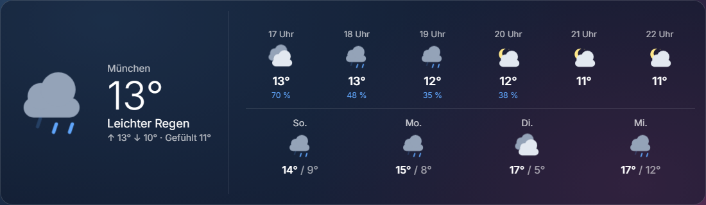

# Animiertes Wetter · Animated Weather

**[Deutsch](#deutsch) · [English](#english)** · Plugin für / for [Home Screens](https://github.com/home-screens/home-screens) · v0.1.0

<p align="center"></p>

## Deutsch

Aktuelles Wetter mit **Stunden- und Tagesvorhersage** und **animierten Wettersymbolen** (drehende Sonne, fallender Regen, blitzende Gewitterwolke …). Die Daten kommen von Open-Meteo – **kein API-Key nötig**.

### Was kann das Plugin?

- Temperatur, Wetterlage, Höchst-/Tiefstwerte, gefühlte Temperatur
- Vorhersage für die nächsten Stunden (inkl. Regenwahrscheinlichkeit) und Tage
- Animierte Symbole, getrennt nach Tag/Nacht

### Installation – Schritt für Schritt

**Voraussetzung:** Du hast Home Screens bereits laufen (Server erreichbar im Browser).

1. Öffne den **Editor** deines Home-Screens-Servers im Browser an einem Computer (nicht am Handy; er braucht mindestens 768 Pixel Breite). Die Adresse ist meist `http://<Adresse-deines-Servers>:3000/editor`.
2. Klicke oben in der Leiste auf **Plugins** (neben „Einstellungen“ und „Vorschau“).
3. Klicke auf **Aus URL installieren …**.
4. Füge im Feld **Tarball-URL** diesen Link ein und klicke auf **Installieren**:

   ```
   https://github.com/Gyrosguenter/home-screens-plugin-weather/releases/latest/download/weather-animated.tar.gz
   ```

   Home Screens weist darauf hin, dass das Plugin „nicht vom Home-Screens-Team geprüft“ ist. Das ist normal, denn es stammt nicht aus dem Marktplatz. Du siehst eine Übersicht, was das Plugin darf.
5. Warte, bis die Installation fertig ist, und klicke auf **Fertig**. Falls das Modul nicht sofort in der Liste auftaucht, lade die Seite neu (F5).
6. Ziehe das Modul auf den Bildschirm: Links in der Liste **MODULE** (Hinweis „Auf den Bildschirm ziehen“) findest du unter **WETTER & UMWELT** das Modul **Wetter (animiert)** (mit der Markierung „Plug-in“). Ziehe es auf deinen Bildschirm und passe Größe und Position an.
7. Klicke das Modul an: rechts erscheinen die **Einstellungen**. Der Editor **speichert automatisch**, einen Speichern-Knopf gibt es nicht.

### Einstellungen

| Einstellung | Bedeutung |
|---|---|
| Ortsname | Nur Anzeige (z. B. `München`). Leer = kein Ortsname. |
| Breitengrad / Längengrad | Koordinaten deines Ortes, z. B. `48.1371` / `11.5754`. **Tipp:** In Google Maps mit Rechtsklick auf den Ort die Koordinaten kopieren. |
| Stunden der Vorhersage | Wie viele Stunden gezeigt werden (Standard 6). |
| Tage der Vorhersage | Wie viele Tage gezeigt werden (Standard 4). |
| Aktualisierung (ms) | Standard 10 Minuten. |

### Aktualisieren

Wiederhole einfach die Installation mit **demselben Link** (Schritte 2–4). Er zeigt immer auf die neueste Version; deine Einstellungen bleiben erhalten.

### Hilfe bei Problemen

- **Falscher Ort?** Breiten- und Längengrad eintragen (Standard ist München).
- **Zeigt „Wetterdaten momentan nicht verfügbar“?** Der Server braucht Internetzugang zu `api.open-meteo.com`.
- **Installation schlägt fehl?** Dein Home-Screens-Server muss auf `github.com` zugreifen können (Internet). Prüfe, ob der Link vollständig kopiert wurde.
- **Modul bleibt leer nach dem Ziehen?** Seite neu laden (F5). Ein paar Sekunden warten, manche Module laden Daten erst nach dem Einfügen.

### Datenschutz und Hinweise

Das Modul fragt über den Server-Proxy `api.open-meteo.com` mit den eingetragenen Koordinaten ab. Sonst werden keine Daten gesendet.

---

## English

Current weather with **hourly and daily forecast** and **animated weather icons** (turning sun, falling rain, flashing thunderclouds …). Data comes from Open-Meteo – **no API key needed**.

### What does it do?

- Temperature, conditions, high/low, feels-like temperature
- Forecast for the next hours (with precipitation chance) and days
- Animated icons, separate for day/night

### Installation – step by step

**Prerequisite:** Home Screens is already running (server reachable in the browser).

1. Open the **editor** of your Home Screens server in a browser on a computer (not a phone; it needs at least 768 pixels width). The address is usually `http://<address-of-your-server>:3000/editor`.
2. Click **Plugins** in the top bar (next to "Settings" and "Preview").
3. Click **Install from URL…**.
4. Paste this link into the **Tarball URL** field and click **Install**:

   ```
   https://github.com/Gyrosguenter/home-screens-plugin-weather/releases/latest/download/weather-animated.tar.gz
   ```

   Home Screens warns that the plugin "has not been reviewed by the Home Screens team". That is normal because it does not come from the marketplace. You will see an overview of what the plugin may do.
5. Wait until the installation has finished and click **Done**. If the module does not show up in the list immediately, reload the page (F5).
6. Drag the module onto the screen: in the **MODULES** list on the left ("Drag onto the screen") find **Wetter (animiert)** under **WEATHER & ENVIRONMENT** (marked "Plugin"). Drag it onto your screen and adjust size and position.
7. Click the module: the **settings** appear on the right. The editor **saves automatically**; there is no save button.

### Settings

| Setting | Meaning |
|---|---|
| Location name | Display only (e.g. `Munich`). Empty = no name. |
| Latitude / Longitude | Coordinates of your place, e.g. `48.1371` / `11.5754`. **Tip:** right-click the place in Google Maps to copy its coordinates. |
| Hours of forecast | How many hours are shown (default 6). |
| Days of forecast | How many days are shown (default 4). |
| Refresh (ms) | Default 10 minutes. |

### Updating

Simply repeat the installation with the **same link** (steps 2–4). It always points to the latest version; your settings are kept.

### Troubleshooting

- **Wrong place?** Enter latitude and longitude (default is Munich).
- **Shows "Wetterdaten momentan nicht verfügbar" (weather data currently unavailable)?** The server needs internet access to `api.open-meteo.com`.
- **Installation fails?** Your Home Screens server must be able to reach `github.com` (internet). Check that the link was copied completely.
- **Module stays empty after dragging?** Reload the page (F5). Wait a few seconds; some modules fetch data only after being added.

### Privacy and notes

The module queries `api.open-meteo.com` through the server proxy with the coordinates you entered. Nothing else is sent.

---

## Technik / Technical notes

- **ID / Manifest:** `weather-animated` – Version 0.1.0, License MIT
- Bauen / Build: `npm install && npm run build && npm test`
- Release-Archiv für die Installation / Release archive used for installation: `weather-animated.tar.gz` (enthält / contains `weather-animated/manifest.json` + `weather-animated/dist/bundle.js`)
- Teil eines privaten Heim-Projekts (Magic-Mirror-Ersatz); als eigenes öffentliches Repo geführt, damit die Installations-URL ohne Anmeldung erreichbar ist / Part of a private home project (Magic Mirror replacement); kept as its own public repo so the install URL works without login.
- Dieses Plugin ist ein inoffizielles Community-Plugin und steht in keiner Verbindung zum Home-Screens-Team / This is an unofficial community plugin and is not affiliated with the Home Screens team.

MIT
